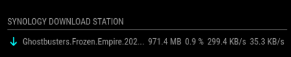

# MMM-Synology-Download_Station [](https://raw.githubusercontent.com/TAGinside/MMM-Synology-Download_Station/master/LICENSE)

This [MagicMirror²](https://github.com/MagicMirrorOrg/MagicMirror) module displays the tasks of Synology Download Station (status, name, size, progress, download and upload speed).



## Features

- One line per task, with a colored status icon.
- Choose which columns and which task statuses are shown.
- The module hides itself when there is nothing to show (can be turned off).
- One DSM session is kept open and renewed only when it expires.
- No npm dependency.

## Dependencies

| Service | Link | Key required? | Limits |
|---|---|---|---|
| Synology DSM Web API (`SYNO.API.Auth`, `SYNO.DownloadStation.Task`) | [Download Station Web API](https://global.download.synology.com/download/Document/Software/DeveloperGuide/Package/DownloadStation/All/enu/Synology_Download_Station_Web_API.pdf) | A DSM account allowed to use Download Station | Local network only, no quota |

- An installation of [MagicMirror²](https://github.com/MagicMirrorOrg/MagicMirror).
- A Synology NAS with the **Download Station** package installed and running.
- A DSM account with access to Download Station. A dedicated account without admin rights is recommended. 2-step verification must be off for this account.

## Installation

Go to the `modules` folder of MagicMirror²:

```sh
cd ~/MagicMirror/modules
```

Clone this repository:

```sh
git clone https://github.com/TAGinside/MMM-Synology-Download_Station
```

Add the module to `~/MagicMirror/config/config.js` (see [Configuration](#configuration)), then check the file and restart MagicMirror²:

```sh
cd ~/MagicMirror
node --run config:check
```

## Update

```sh
cd ~/MagicMirror/modules/MMM-Synology-Download_Station
git pull
```

Then restart MagicMirror².

## Configuration

Add this block to the `modules` array of `~/MagicMirror/config/config.js`:

```javascript
    {
      module: "MMM-Synology-Download_Station",
      position: "bottom_left",
      header: "Synology Download Station",
      config: {
        host: "192.168.1.10",      // IP or hostname of your NAS
        useHttps: true,            // port 5001 is used when port is not set
        user: "YOUR_DSM_USER",
        passwd: "YOUR_DSM_PASSWORD",
        refreshInterval: 10,       // seconds
        maxItems: 8
      }
    },
```

To change the columns or the task statuses, give only the keys you want to change. The other keys keep their default value:

```javascript
      config: {
        // ...
        displayColumns: { size: false, speed_upload: false },
        displayTasks: { finished: false, seeding: false }
      }
```

## Options

| Option | Description | Default |
|---|---|---|
| `host` | IP address or hostname of the NAS. **Required.** | `null` |
| `port` | DSM port. When `null`, `5001` is used with HTTPS and `5000` with HTTP (DSM default ports). | `null` |
| `useHttps` | Connect to DSM with HTTPS. The self-signed certificate of the NAS is accepted. | `false` |
| `user` | DSM account. **Required.** | `null` |
| `passwd` | Password of the DSM account. **Required.** | `null` |
| `refreshInterval` | Refresh interval in seconds (minimum `5`). | `10` |
| `maxItems` | Maximum number of tasks displayed. | `5` |
| `compactMode` | `true`: the task name is cut after `compactMaxLen` characters. `false`: the full name is shown. Recommended for `top_left`, `top_right`, `bottom_left`, `bottom_right`. | `true` |
| `compactMaxLen` | Maximum number of characters of the task name when `compactMode` is `true`. | `30` |
| `textSize` | Text size: `xsmall`, `small`, `medium`, `large` or `xlarge`. | `"xsmall"` |
| `iconSize` | Size of the status icons: `xsmall`, `small`, `medium`, `large` or `xlarge`. | `"small"` |
| `hideWhenEmpty` | `true`: the module is hidden when there is no task to show or when the NAS cannot be reached. `false`: `msgEmptyList` or the error is displayed. | `true` |
| `msgEmptyList` | Text displayed when there is no task (only with `hideWhenEmpty: false`). | `"No Download Tasks"` |
| `displayColumns` | Columns to show: `status_icon`, `title`, `size`, `percent_completed`, `speed_download`, `speed_upload`. | all `true` |
| `displayTasks` | Task statuses to show: `waiting`, `downloading`, `paused`, `finishing`, `finished`, `hash_checking`, `seeding`, `filehosting_waiting`, `extracting`, `error`. | all `true` |

Status icons: arrow down (cyan) downloading, arrow up (green) seeding, check (green) finished, pause (gray) paused, hourglass (gray) waiting, rotate (gray) hash checking, spinner / box (cyan) finishing / extracting, triangle (red) error.

## Troubleshooting

If the module is not displayed, either the NAS cannot be reached or there is no task to show. Set `hideWhenEmpty: false` to see the message on the mirror, and read the MagicMirror² logs (`pm2 logs` if you start it with pm2, or the terminal):

| Log line | Meaning |
|---|---|
| `connected to <host>` | Login OK. Printed once, then again only when the session has to be renewed. |
| `login to <host> failed: wrong account or password` | Check `user` and `passwd`. Other reasons: account disabled, 2-step verification required, IP blocked by the NAS (*Control Panel > Security > Protection*). |
| `no answer from <host>:<port>` or `connect ECONNREFUSED` | Wrong `host`, `port` or `useHttps`, or the NAS is off. The module waits 10 s for an answer (30 s for the login, which is slow while MagicMirror starts). |
| `Download Station error <code>` | Download Station is not installed or not running, or the account has no access to it. |
| `connection to <host> restored` | The NAS answers again after an error. |

Each error is logged once, not at every refresh.

## License

MIT, see [LICENSE](LICENSE).
